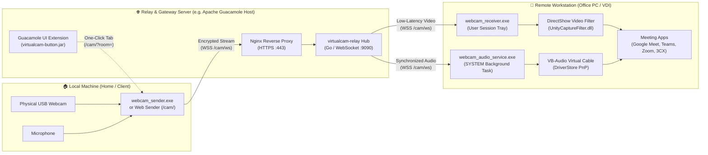
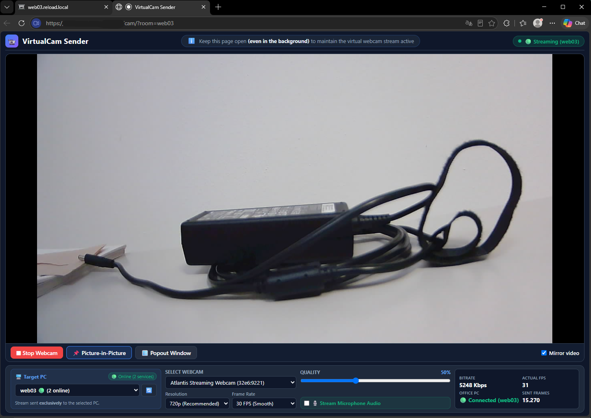
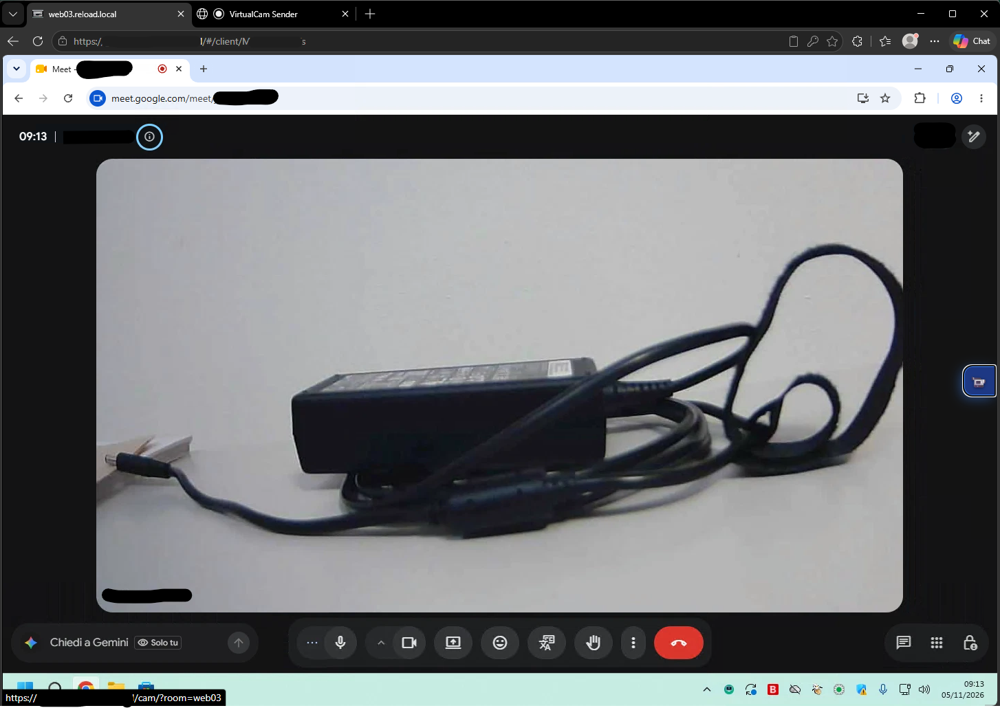

# Virtual Webcam for Apache Guacamole (`virtual_webcam`)

An enterprise-grade, ultra-low-latency solution for bridging physical webcams and microphones from local client computers (e.g., home PCs) into remote desktop sessions (e.g., Apache Guacamole, RDP, VNC). 

Virtual Webcam exposes incoming remote video as a native Windows DirectShow capture filter (**"Virtual Webcam"**) and incoming remote audio as a virtual audio input device (**"Virtual Webcam Mic"** / VB-Audio Cable). Applications running on the remote workstation—including **Google Meet, Microsoft Teams, Zoom, 3CX, Chrome, Edge, and Firefox**—recognize the stream as hardware peripherals with zero configuration.

---

## 🏗️ Architecture & Data Flow



---

## 📸 Screenshots

<p align="center">
  
  <br>
  <em><b>1. Web Sender Interface:</b> Broadcast physical webcam & microphone directly from any browser with real-time controls, resolution/FPS presets, quality slider, and live bitrate metrics.</em>
</p>

<br>

<p align="center">
  
  <br>
  <em><b>2. Remote Guacamole Session:</b> Video conferencing apps (e.g. Google Meet, Microsoft Teams) recognizing the incoming stream as native "Virtual Webcam" hardware, with the floating one-click launcher button (📹) on the right edge.</em>
</p>

---

## ✨ Key Features

* **Zero-Latency Streaming (<50ms):** Highly optimized WebSocket binary protocol using direct memory buffers and frame synchronization.
* **Native DirectShow Driver Integration:** Custom C++ 32-bit and 64-bit DirectShow filter (`UnityCaptureFilter.dll`) dynamically feeds raw frames into Windows shared memory. Meeting software cannot distinguish it from a physical USB camera.
* **Synchronized Audio Bridge:** High-fidelity 16kHz PCM audio routing directly into VB-Audio Cable (`CABLE Input` -> `CABLE Output`), giving remote meeting participants clean audio.
* **Dual Sender Options:**
  * **Native Windows Tray Sender (`webcam_sender.exe`):** Standalone tray application with USB device selector, live preview, Picture-in-Picture (PiP), autostart, and tray minimization.
  * **Zero-Install Web Sender (`/cam/`):** Pure HTML5/JavaScript WebRTC/Canvas interface that works instantly in any modern browser without installing any software on the local client.
* **Apache Guacamole Extension (`virtualcam-button.jar`):** Seamless floating camera icon (`📹`) pinned to the middle-right of the Guacamole interface. Automatically detects the active connection name/hostname and launches `/cam/?room=<room>` in a new tab with one click.
* **Multi-Room Isolation:** Workstations automatically claim rooms based on their hostname (e.g., `web03`, `pc-john`), ensuring that streams never collide between different users on the network.
* **Silent Enterprise GPO Deployment:** Automated batch scripts (`install_gpo.bat`) for Active Directory Group Policy distribution, handling driver installation, scheduled tasks, registry run keys, and unblocking downloaded binaries.
* **Robust Diagnostic & Maintenance Tools:**
  * Integrated real-time tray metrics (FPS, resolution, bitrate, dropped frames).
  * Fast driver recovery script (`restore_webcam_driver.bat`).
  * Full uninstaller (`uninstall.bat`) that safely stops services, removes registry keys, and deletes scheduled tasks.

---

## 📁 Repository Structure

```text
Webcam-Virtual-Apache-Guacamole/
├── client-audio-service/         # Background audio injection service (Go)
│   ├── main.go                  # WebSocket audio consumer -> VB-Cable feeder
│   └── webcam_audio_service.exe # Compiled 64-bit Windows binary
├── client-receiver/              # Video receiver application (Go)
│   ├── main.go                  # WebSocket video client & DirectShow IPC feeder
│   ├── driver_embed/            # Embedded DirectShow filter DLLs
│   └── webcam_receiver.exe      # Compiled Windows tray application
├── client-sender/                # Native Windows webcam broadcaster (Go)
│   ├── main.go                  # Camera capture & tray interface
│   ├── start_webcam.bat         # Standalone app mode launcher
│   └── webcam_sender.exe        # Compiled standalone sender binary
├── deploy_gpo/                   # Centralized Active Directory deployment bundle
│   ├── config.json              # Client connection configuration
│   ├── config.example.json      # Template configuration
│   ├── install_gpo.bat          # Silent Active Directory GPO startup script
│   ├── uninstall.bat            # Clean removal script
│   ├── README_GPO.md            # GPO configuration step-by-step guide
│   ├── driver/                  # DirectShow 32/64-bit filters
│   └── vbcable/                 # VB-Audio Cable signed driver packages
├── driver/                       # Standalone driver packages & manual installers
│   ├── install_virtual_webcam.bat
│   └── uninstall_virtual_webcam.bat
├── guacamole-extension/          # Apache Guacamole Web UI Addon
│   ├── guac-manifest.json       # Guacamole extension manifest
│   ├── css/cam-button.css       # Floating tab styling
│   ├── js/cam-button.js         # Room detection & button injection script
│   └── virtualcam-button.jar    # Compiled Guacamole extension JAR
├── screenshot/                   # User interface & session screenshots
│   ├── 1.png                     # Guacamole session with Google Meet & launcher button
│   └── 2.png                     # Web Sender broadcasting dashboard
├── server-relay/                 # Central streaming hub & Web Sender
│   ├── main.go                  # Go HTTP/WebSocket streaming server
│   ├── Dockerfile               # Container build definition
│   ├── docker-compose.snippet.yml
│   ├── nginx-virtualcam.conf    # Nginx reverse proxy template
│   ├── virtualcam-relay.service # Linux systemd service unit
│   ├── virtualcam-relay-linux   # Compiled native Linux binary (amd64)
│   └── static/index.html        # Web Sender HTML5/JS interface
├── restore_webcam_driver.bat     # Helper script to re-register DirectShow filters
├── uninstall.bat                 # Global workstation cleanup script
└── README.md                     # Project documentation
```

---

## 🚀 Installation & Deployment Guide

### 1. Server Setup (Debian / Ubuntu / Apache Guacamole Host)

#### Option A: Native Linux Binary & Systemd
1. Copy `server-relay/virtualcam-relay-linux` and `server-relay/static` to `/opt/virtual_webcam/` on your server:
   ```bash
   sudo mkdir -p /opt/virtual_webcam/static
   sudo cp server-relay/virtualcam-relay-linux /opt/virtual_webcam/virtualcam-relay
   sudo cp -r server-relay/static/* /opt/virtual_webcam/static/
   sudo chmod +x /opt/virtual_webcam/virtualcam-relay
   ```
2. Install and enable the `systemd` service:
   ```bash
   sudo cp server-relay/virtualcam-relay.service /etc/systemd/system/
   sudo systemctl daemon-reload
   sudo systemctl enable --now virtualcam-relay
   ```
3. Confirm the relay is running on port 9090:
   ```bash
   sudo systemctl status virtualcam-relay
   ```

#### Option B: Docker / Docker Compose
1. Build and run via Docker Compose using the provided [`server-relay/docker-compose.snippet.yml`](server-relay/docker-compose.snippet.yml):
   ```bash
   cd server-relay
   docker build -t virtualcam-relay:latest .
   docker run -d --name virtualcam-relay --restart unless-stopped -p 127.0.0.1:9090:9090 virtualcam-relay:latest
   ```

#### Step 2: Configure Nginx Reverse Proxy
Add the locations from [`server-relay/nginx-virtualcam.conf`](server-relay/nginx-virtualcam.conf) inside your Guacamole Nginx `server { listen 443 ssl; ... }` block:
```nginx
location = /cam {
    return 301 /cam/;
}

location /cam/ {
    # If relay runs natively on host and Nginx in Docker, replace with Docker gateway (e.g. 172.18.0.1:9090)
    proxy_pass http://127.0.0.1:9090/cam/;
    proxy_http_version 1.1;
    proxy_set_header Host $http_host;
    proxy_set_header X-Real-IP $remote_addr;
    proxy_set_header X-Forwarded-For $proxy_add_x_forwarded_for;
    proxy_set_header X-Forwarded-Proto $scheme;
}

location /cam/ws {
    proxy_pass http://127.0.0.1:9090/ws;
    proxy_http_version 1.1;
    proxy_set_header Upgrade $http_upgrade;
    proxy_set_header Connection "upgrade";
    proxy_set_header Host $http_host;
    proxy_set_header X-Real-IP $remote_addr;
    proxy_set_header X-Forwarded-For $proxy_add_x_forwarded_for;
    proxy_set_header X-Forwarded-Proto $scheme;
    proxy_buffering off;
    proxy_read_timeout 86400s;
    proxy_send_timeout 86400s;
}
```
Reload Nginx:
```bash
sudo nginx -s reload
# Or if running Nginx in Docker:
sudo docker exec guac-nginx nginx -s reload
```

#### Step 3: Install the Apache Guacamole UI Extension
1. Copy `guacamole-extension/virtualcam-button.jar` into your Guacamole extensions directory:
   ```bash
   sudo cp guacamole-extension/virtualcam-button.jar /opt/guacamole/extensions/
   ```
2. Restart Apache Guacamole:
   ```bash
   sudo docker restart guacamole
   # Or for native Tomcat:
   sudo systemctl restart tomcat9
   ```

---

### 2. Client Setup (Remote Workstations / Office PCs)

#### Option A: Active Directory GPO (Recommended for Enterprises)
1. Copy the `deploy_gpo` directory to your Domain Controller's share (e.g., `\\yourdomain.local\NETLOGON\deploy_gpo`).
2. Edit `config.json` (or copy from `config.example.json`) in the share to point to your relay URL:
   ```json
   {
     "relay_url": "wss://guacamole.yourdomain.com/cam/ws",
     "room": "auto",
     "token": ""
   }
   ```
3. In **Group Policy Management** (`gpmc.msc`), create a GPO linked to your Workstations OU.
4. Set the **Computer Startup Script** to:  
   `\\yourdomain.local\NETLOGON\deploy_gpo\install_gpo.bat`
5. At the next workstation boot, the script will silently install drivers, register the audio service, and configure autostart for all users.

#### Option B: Standalone / Manual Installation
1. Open PowerShell / Command Prompt as **Administrator** in the project directory.
2. Run `install_gpo.bat` or `driver\install_virtual_webcam.bat`.
3. Launch `webcam_receiver.exe`. The camera icon will appear in the system tray.

---

### 3. Broadcaster Setup (Home / Local PC)

Users at home have two effortless ways to send their webcam:

#### Method 1: Web Sender (Zero-Install)
1. In your Apache Guacamole session, click the floating camera button (`📹`) on the right side of the screen.
2. A new browser tab opens to `https://guacamole.yourdomain.com/cam/?room=<your-pc>`.
3. Allow browser camera and microphone permissions and click **"Start Camera"**.
4. Your video and audio are instantly live on your remote workstation!

#### Method 2: Native Windows Sender (`webcam_sender.exe`)
1. Download `webcam_sender.exe` to the local PC.
2. Launch `webcam_sender.exe`.
3. Select your webcam from the dropdown, preview your video feed, and minimize to the system tray.

---

## 🛠️ Building from Source

### Prerequisites
* Go 1.21 or higher installed (`go version`)
* Git
* Java Development Kit (JDK) or `zip` utility (for repacking the Guacamole extension)

### 1. Build the Relay Hub (Linux)
```bash
cd server-relay
CGO_ENABLED=0 GOOS=linux GOARCH=amd64 go build -ldflags="-s -w" -o virtualcam-relay-linux main.go
```

### 2. Build the Video Receiver (`webcam_receiver.exe`)
```powershell
cd client-receiver
go build -ldflags "-H windowsgui -s -w" -o webcam_receiver.exe main.go
```

### 3. Build the Audio Service (`webcam_audio_service.exe`)
```powershell
cd client-audio-service
go build -ldflags "-H windowsgui -s -w" -o webcam_audio_service.exe main.go
```

### 4. Build the Webcam Sender (`webcam_sender.exe`)
```powershell
cd client-sender
go build -ldflags "-H windowsgui -s -w" -o webcam_sender.exe main.go
```

### 5. Repack the Guacamole Extension (`virtualcam-button.jar`)
```bash
cd guacamole-extension
# Using jar tool:
jar -cvf virtualcam-button.jar guac-manifest.json css/ js/
# Or using zip in PowerShell:
Compress-Archive -Path guac-manifest.json, css, js -DestinationPath virtualcam-button.zip -Force
Move-Item virtualcam-button.zip virtualcam-button.jar -Force
```

---

## ⚙️ Configuration Reference

### Configuration Files & Parameters
Located in the application directory or `%LOCALAPPDATA%\VirtualWebcam\config.json`:

| Parameter | Type | Default | Description |
|---|---|---|---|
| `relay_url` | `string` | `wss://.../cam/ws` | WebSocket endpoint on your reverse proxy or relay server |
| `room` | `string` | `"auto"` | Workstation room name. `"auto"` uses the local Windows computer hostname |
| `token` | `string` | `""` | Optional authentication security token |

### Environment Variables
All client binaries support environment variable overrides without touching configuration files:

| Variable | Target Component | Description |
|---|---|---|
| `VIRTUALCAM_RELAY_URL` | Receiver & Audio Service | WebSocket endpoint (e.g. `wss://guacamole.yourdomain.com/cam/ws`) |
| `VIRTUALCAM_ROOM` | Receiver & Audio Service | Custom room override (e.g. `pc-office-01`) |
| `VIRTUALCAM_TOKEN` | Receiver & Audio Service | Authentication token |
| `VIRTUALCAM_URL` | Sender | Target Web Sender URL |
| `PORT` | Server Relay | HTTP/WebSocket listening port (default `9090`) |
| `STATIC_DIR` | Server Relay | Custom directory for Web Sender static assets |
| `AUTH_TOKEN` | Server Relay | Require token for incoming stream connections |

### URL Query Parameters (Web Sender)
* `https://guacamole.yourdomain.com/cam/?room=web03`: Connects directly to room `web03`.
* `https://guacamole.yourdomain.com/cam/?room=web03&token=mysecret`: Connects with an authentication token.

---

## 🔍 Diagnostics & Troubleshooting

| Symptom | Cause | Resolution |
|---|---|---|
| **Meeting apps do not list "Virtual Webcam"** | DirectShow filter is not registered in Windows. | Run `restore_webcam_driver.bat` as Administrator, or check `regsvr32` output in logs. |
| **Video shows black screen** | Sender is not streaming, or room name mismatch. | Ensure both sender and receiver are on the same room name (check receiver tray tooltip). |
| **Microphone not audible in meetings** | Audio service is stopped or default audio device mismatch. | Ensure `CABLE Input` and `CABLE Output` are present in Sound Settings. Verify `VirtualCamAudioService` task is running. |
| **WebSocket connection fails** | Proxy buffering or SSL mismatch. | Verify Nginx configuration has `proxy_buffering off;` and WebSocket upgrade headers enabled. |

### Diagnostic Logs
* **Workstation Receiver Log:** `%LOCALAPPDATA%\VirtualWebcam\webcam_receiver.log` or via tray menu (`Open Debug Log`).
* **Workstation Audio Log:** `C:\Program Files\VirtualWebcam\webcam_audio.log`.
* **Sender Log:** `%LOCALAPPDATA%\VirtualWebcamSender\webcam_sender.log`.
* **Server Relay Log:** `/var/log/virtualcam-relay.log` or `journalctl -u virtualcam-relay -f`.

---

## 🛡️ Uninstallation

To cleanly remove all drivers, services, scheduled tasks, and registry keys from a workstation:
1. Run `uninstall.bat` as **Administrator**.
2. All components, registry entries, and virtual drivers are removed cleanly.

---

## ☕ Support the Project

If this virtual webcam and audio solution has been helpful for your Apache Guacamole environment or you appreciate open-source projects, consider supporting development by buying me a virtual coffee! ❤️

[](https://paypal.me/MatteoSacanna)

---

## 📄 License
This project incorporates open-source DirectShow capture filtering (based on UnityCapture by schellingb, MIT License) and VB-Audio Virtual Cable runtime packages. All custom Go relay, receiver, sender, and Guacamole extension code are distributed under the MIT License.
